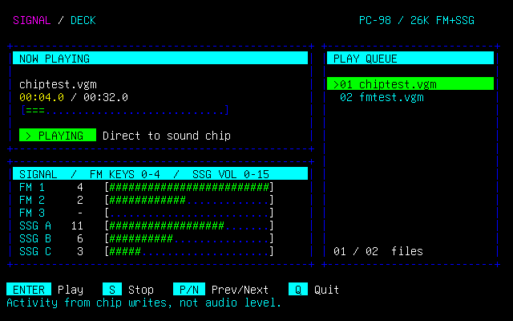
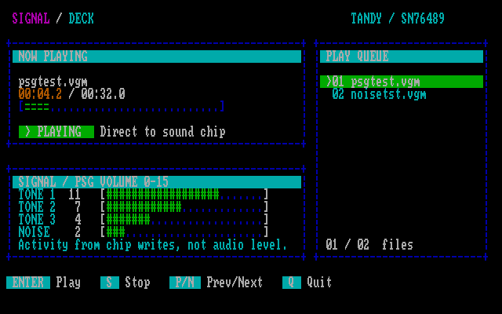

# Signal Deck for ELKS

An 80×25 keyboard player for real-mode ELKS. The PC-98 and Tandy
screens show actual key/volume state sent to the selected chip, not a
spectrum or an estimate of sound pressure. On the direct PC-98 and
Tandy screens the meters repaint about ten times a second, redraw only
the cells that changed, and briefly hold a peak marker that also catches
key-ons and volume blips between repaints. A due chip write always goes
before the display, which only uses spare time between writes. The two Sound Blaster paths
are separate: digital PCM through ELKS or melodic OPL2 at port 388h.

## Screenshots

Captured in DOSBox-X running ELKS with non-musical chip test signals.

**PC-98 / 26/K FM + SSG**



**Tandy 1000 / SN76489 PSG**



## Start the deck

Copy the executables to ELKS (`/bin/elksvgm`, plus `/bin/sbpcm` for PCM and
`/bin/opl2play` for OPL2). Make them executable and copy the appropriate
tracks to a directory on the guest. For the 26K streaming mode, also
install `/bin/26kplay`; for the Tandy streaming mode, `/bin/tandyplay`. The `elksvgm` executable also runs
from a copied folder as `./elksvgm`; PCM and OPL2 still need their
respective helpers in `/bin`. Run from an ANSI-enabled 80×25 console:

```sh
elksvgm --deck --pc98-26ks track1.vgm track2.vgm
elksvgm --deck --pc98-26k track.vgm
elksvgm --deck --pc98-stream track1.vgm --percussion track1.cue track2.vgm
elksvgm --deck --tandy-ex track.vgm
elksvgm --deck --tandy-stream long1.vgm long2.vgm
elksvgm --deck --sb-pcm track1.wav track2.wav
elksvgm --deck --adlib-388 track.vgm
```

Use the hardware mode that matches the installed, idle device. File
case should match the names on the guest filesystem. Press **Enter**
to play the selected track from the start, **S** to stop, **P/N** to
switch tracks, and **Q** to quit. Switching during playback stops the
current track and starts the newly selected track.

**A** cycles what happens when a track ends: **Once** (stop; the
default), **Next** (play the next track, stopping after the last) or
**All** (repeat the queue). In Next and All a looping score plays its
loop body `N` times (`--deck --loops N`, default 2) and fades out over
the last five seconds before the deck moves on; in Once, streamed
scores loop until Stop and direct scores play once. The fade lowers PSG
levels, YM2203 carrier levels and SSG fixed levels; an SSG voice on the
hardware envelope drops out half way through the fade.

- **PC-9801-26/K** at I/O 188h (`No 26/K at 188h` means nothing
  answered there; in DOSBox-X set `pc-98 fm board io port=0x188`, whose
  default is 0x88): raw, single YM2203 stream at 3.9936 MHz. Use
  `--pc98-26ks` for FM and fixed-volume SSG tone/noise, or
  `--pc98-26k` for FM only. FM-only tracks work in either queue. The
  SSG mode preserves GPIO direction, does not touch GPIO data ports,
  and refuses timer or hardware-envelope commands. It requires successful
  SSG readback before playback.
- **Tandy 1000 EX**: raw single-chip SN76489-style PSG stream at 3.579545 MHz.
- **Sound Blaster PCM**: uncompressed 8-bit unsigned mono WAV, 4–20 kHz,
  through a working ELKS `/dev/dsp`. Use a kernel with its Sound Blaster PCM driver.
- **AdLib / Sound Blaster OPL2**: raw single YM3812 melodic stream at
  3.579545 MHz and a confirmed idle OPL2-compatible interface at 388h;
  no rhythm mode or OPL3 features. This is not a PCM mode.

The ordinary VGM modes have an 8 KiB and two-minute limit. None plays
VGZ, data blocks or multi-chip scores, and only `--pc98-stream` replays
loops. PCM is limited to four minutes. The `--pc98-stream` and
`--tandy-stream` views show live meters and a clock reported by their
helpers; the delegated PCM and
OPL2 views do not report live meters or a clock.
The deck does not pause, seek, mute individual channels or fade.

### Tandy streaming

`--tandy-stream` runs `/bin/tandyplay` for scores beyond the direct
player's 8 KiB and two minutes: raw single-chip SN76489-family VGM at
3.579545 MHz with the Tandy noise shape (feedback 0x0006, 15-bit shift
register, no flags), up to 512 KiB and ten minutes, on a Tandy 1000 EX.
It shares `26kplay`'s streaming core: a full validating walk before any
port write, a GD3 tag validated and skipped, the loop point replayed until
Stop or Next, live meters and clock, and all four channels muted on exit.
Only `0x50` PSG writes are accepted; a data byte must follow a tone
latch. Game Gear stereo, other chips, other clocks and the Sega or BBC
noise shapes are refused. If the first PSG byte after the loop point is a
data byte whose latch differs at the end of the song, the track plays
once instead of looping. `tandyplay --check FILE.VGM` validates without
hardware access.

### Optional 26K streaming and beeper cues

`--pc98-stream` is a separate real-mode PC-98 mode behind `/bin/26kplay`.
It accepts bounded raw single-YM2203 VGM with a 128-byte header
(256 KiB/300 s max), using an idle reset-default 26/K board. It accepts
3.9936 MHz and 4 MHz scores; playing the latter on a 26/K lowers pitch
about 0.16%. Stock `--pc98-26ks` is unchanged.

Beyond the direct player's FM and fixed-volume SSG writes, the helper
accepts exactly these YM2203 writes: `0x27 = 0x40` (FM3 special mode,
timers left stopped), `0x2D = 0x00` (the reset-default prescaler), the
FM3 slot frequencies `0xA8–0xAA`/`0xAC–0xAE`, and the SSG hardware
envelope (`0x0B`/`0x0C` period, `0x0D` shape 0–15, level `0x10` in
`0x08–0x0A`). Timer values and timer/IRQ bits in `0x27`, `0x2E`/`0x2F`,
the SSG I/O ports `0x0E`/`0x0F` and every other register are refused
before any hardware write. A GD3 tag is validated (`Gd3 ` v1.00, exact
length, eleven terminated strings) and skipped, never displayed. The
header's AY8910 flag byte `0x7A` may be 0 or 1; a real chip ignores it.

A track with a VGM loop point replays from it until Stop or Next, on
the same absolute schedule. Tracks paired with a cue play once, since a
cue covers a single pass, as do tracks whose header loop length does not
match the score. On exit the helper mutes FM and SSG, then
returns FM3 mode, SSG-EG and the SSG envelope registers it changed to
their reset or read-back values, so the next track does not inherit them.
While the helper validates a score it also copies it to far memory when
ELKS can spare the space, so playback and loop replays never wait on the
disk; otherwise it streams from the file as before. The validating pass
still reads the whole file before the first note, so a large score on a
floppy takes a few seconds to start.
`26kplay --check FILE.VGM [FILE.CUE]` runs the same preflight with no
hardware access.

Under the deck, the helper reports its position, the pass length and the
level per channel about ten times a second over a pipe on fd 3, only in
spare time before its next chip write, and drops a report rather than
wait. SSG voices in hardware-envelope mode show `E`; such a voice sounds
even with tone and noise off. Run on its own, the helper reports nothing.

`--percussion FILE.CUE` applies only to the immediately preceding VGM.
The queue shows `+` beside these tracks. A cue must be authored for that
exact track; the helper checks the duration, and you choose which cue
to pair with each file. It adds pitched kick and snare pulses through the PC-98
built-in speaker, not sample playback. Without an explicit cue, this
mode does not touch the beeper. The optional overlay expects an idle,
reset-default speaker and can refuse an incompatible state. The beeper
is a shared device; do not use another beeper program at the same time.
Playback cleanup gates the speaker off and restores the standard
2 kHz PIT pitch, not a previously programmed custom divider. Use
`pcspeaker=true` in DOSBox-X and set a modest speaker mix, such as
`mixer spkr 18 /noshow` before boot. Full-volume speaker plus 26K can
clip in the emulator's mix. A WAV or a sample ROM is not a cue file.

Timing: the direct player and both streaming helpers schedule chip writes
on a sub-tick clock built from the kernel's jiffies (read once through
`/dev/kmem`) and the count of 8254 channel 0, as ELKS's own `get_ptime()`
does. They sleep to within one ELKS tick of a write and spin the rest,
so writes land within about a millisecond instead of on the next 10 ms
tick. Without `/dev/kmem` they fall back to tick timing.

These backends were exercised in DOSBox-X booting real-mode ELKS.
The combined player has not yet been verified on physical hardware.

Without `--deck`, the PC-98 and Tandy arguments retain one-shot CLI
playback: `elksvgm --pc98-26k track.vgm` and
`elksvgm --tandy-ex track.vgm`.

Build with the ELKS ia16-elf toolchain and `elf2elks` on PATH:
`make ELKS=/path/to/elks`.

Prebuilt executables and music files are not included.
